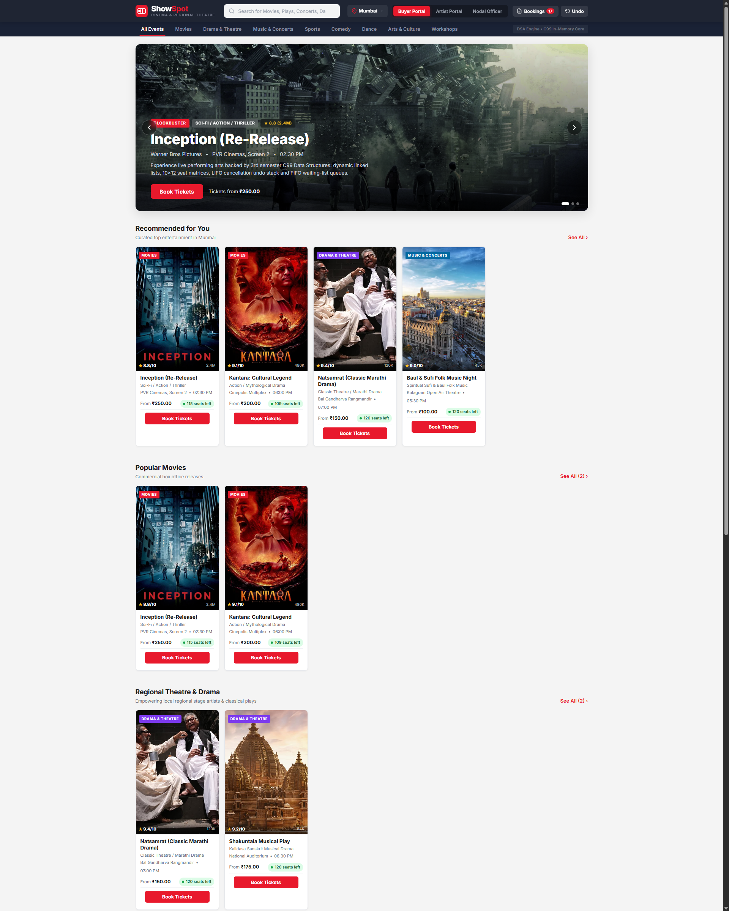

# 🎟️ Movie & Local Theatre Ticket Booking System

A high-performance entertainment ticketing and discovery platform built in **pure C99**, featuring dual interfaces: an interactive **Terminal CLI** and a modern, responsive **Web Interface inspired by BookMyShow**.

The system bridges commercial cinema with regional performing arts (drama, folk dance, Sufi music, and cultural events), powered by classical **Data Structures & Algorithms (DSA)** including dynamic singly linked lists, 10×12 seat matrices, LIFO cancellation undo stacks, and FIFO waiting-list queues with automatic reallocation.

---

## 📸 Web Interface Preview



---

## 📌 Problem Statement

Traditional entertainment ticketing platforms cater primarily to large commercial cinema chains, leaving regional theatres, classical drama troupes, and indigenous folk artists without digital visibility or automated ticketing infrastructure. Furthermore, many educational and enterprise booking architectures either hide foundational data structure mechanics behind high-level frameworks or lack real-world resilience (such as transactional atomicity, binary persistence, cancellation undos, and fair waiting-list queues).

---

## 🎯 Project Objectives

1. **Empower Regional Arts & Commercial Cinema**: Provide a unified platform where commercial blockbusters and grassroots regional stage performances coexist under distinct administrative tiers.
2. **Apply Classical Data Structures**: Implement core data structures (Linked Lists, 2D Matrices, Stacks, Queues) in standard C without third-party runtime libraries.
3. **High-Performance Architecture**: Deliver sub-millisecond response times using an in-memory C engine with pointer-array binary search.
4. **Dual Interface**: Offer both a robust command-line terminal environment and an asynchronous web application served directly by an embedded C HTTP server.
5. **Transactional Integrity & Persistence**: Ensure atomic multi-seat checkouts, stateful undo mechanisms, and binary disk persistence across process lifecycles.

---

## ✨ Features & Functionalities

### 1. Multi-Portal Architecture
- **Buyer Portal**: Discover shows, filter by category/language/venue, select seats on a live 10×12 interactive seating chart, book multiple tickets atomically, view bookings, and cancel tickets.
- **Artist Portal**: Submit regional events (theatre plays, music concerts, folk dance shows) for registration with custom venue, schedule, and pricing.
- **Nodal Officer Portal**: Administrative oversight to review, approve, or reject pending artist events, inspect system audit logs, and analyze revenue metrics.

### 2. Multi-Seat Booking Flow (BookMyShow-Style)
- **Step 1 — Quantity Selection**: Choose from 1 to 10 seats with quick-select pills or an interactive stepper.
- **Step 2 — Seat Matrix Selection**: Interactive 10×12 auditorium layout with real-time selection validation (Rows A–B: VIP, Rows C–J: Regular). Deselect and re-select seats freely before checkout.
- **Step 3 — Price Calculation**: Transparent breakdown showing VIP and Regular counts, unit prices, and grand total.
- **Step 4 — Digital Boarding Pass**: Instant generation of digital ticket passes with unique alphanumeric IDs, seat codes, and transaction summaries.

### 3. FIFO Waiting List & Auto-Allocation
- When an event is sold out (`available_seats == 0`), buyers can join a fair FIFO waiting queue.
- If an existing booking is cancelled, the system automatically dequeues the next attendee in line and allocates the freed seat immediately.

### 4. LIFO Cancellation Undo
- All ticket cancellations are pushed onto an in-memory LIFO stack.
- Accidental cancellations can be restored with a single "Undo" command, reverting the seat to `'X'` and re-instating the booking record.

### 5. Embedded C HTTP Server & REST API
- Built with Windows Sockets (`ws2_32`) in pure C.
- Serves static assets (`index.html`, `style.css`, `app.js`) and handles JSON REST API endpoints without external web servers (e.g. Apache or Nginx).

---

## 🏗️ Data Structures Used

| Data Structure | Implementation | Purpose & Complexity |
|---|---|---|
| **Singly Linked List** | `struct Event *head`<br>`struct Booking *bookingHead` | Dynamic event catalog and booking registry. Allows $O(1)$ insertions without memory re-allocation overhead. |
| **2D Array (Matrix)** | `char seats[10][12]` | 10 rows × 12 columns auditorium seat map (120 seats per event). Rows A–B represent VIP tiers; Rows C–J represent Regular tiers. Access time: $O(1)$. |
| **Stack (LIFO)** | `struct Cancellation *cancelTop` | Manages ticket cancellations with dynamic node allocation. Enables instant $O(1)$ push/pop for the **Undo** operation. |
| **Queue (FIFO)** | `struct WaitlistNode *waitlistHead, *waitlistTail` | Linked queue maintaining fair FIFO sequence for sold-out events. Enqueue and Dequeue operations operate in $O(1)$ time. |

---

## 🔍 Searching & Sorting Techniques

### 1. Pointer-Array Binary Search — $O(\log n)$
To achieve binary search speed over dynamic linked lists:
1. The system scans the linked list and dynamically constructs an array of pointers (`struct Event **` or `struct Booking **`).
2. The pointer array is sorted by primary key (ID) using an in-place sort algorithm.
3. Standard Binary Search is executed over the array:
   $$\text{Time Complexity: } O(\log n)$$
   $$\text{Space Complexity: } O(n) \text{ temporary pointer storage}$$
Implemented in `binarySearchEvents()` and `binarySearchBookings()`.

### 2. Multi-Criteria Linear Search — $O(n)$
Used for human-centric queries where items are matched against text patterns across multiple fields:
- Event Title (case-insensitive substring match)
- Artist / Troupe Name
- Venue Location
- Category Filter (Movies, Drama, Music, Dance, Cultural)

---

## 💾 File Handling & Data Persistence

The system uses custom binary file serialization for compact storage, fast boot times, and data integrity:

- **`events.dat`**: Stores all event records including approval states, schedule, pricing, and 10×12 seat bitmaps.
- **`bookings.dat`**: Stores active booking records with customer details, seat indices, and timestamps.
- **`cancellations.dat`**: Persists the LIFO cancellation stack across application restarts.
- **`waitlists.dat`**: Persists FIFO waiting queue nodes for housefull events.
- **`backup/` Directory**: Contains clean seed data to ensure fail-safe recovery in the event of missing or corrupted files.
- **Safety Mechanism (`isDataSafeToSave`)**: If any critical file is corrupted or unreadable upon startup, saving is locked to prevent overwriting existing data until safely restored.

---

## 💻 Technologies Used

- **Core Backend**: C language (C99 Standard: `gcc -std=c99 -Wall -Wextra -pedantic`)
- **Networking**: Windows Sockets API (`ws2_32`)
- **Frontend**: HTML5, Modern CSS3 (CSS Grid, Flexbox, Custom Properties), Vanilla JavaScript (ES6+)
- **Asset Integration**: High-definition posters and banners from verified CDNs (TMDb, Amazon Media, Unsplash)
- **Tooling**: MinGW-w64 / GCC, Git

---

## 📂 Project Structure

```text
Movie_Booking/
├── main.c                 # CLI console application entry point
├── server.c               # Embedded Winsock HTTP REST API & static file server
├── project.h              # Common structs, constants, and function prototypes
├── events.c               # Event linked list management, seat matrices, pointer binary search
├── bookings.c             # Booking management, multi-seat atomic transactions
├── stack.c                # LIFO cancellation stack & undo operations
├── queue.c                # FIFO waitlist queue & auto-reallocation
├── portals.c              # CLI interface for Buyer, Artist, and Nodal Officer
├── events.dat             # Binary persistence: Events & seat maps
├── bookings.dat           # Binary persistence: Active customer bookings
├── cancellations.dat      # Binary persistence: Cancellation history (Stack)
├── waitlists.dat          # Binary persistence: Waiting list queues
├── backup/                # Seed backup binary datasets
│   ├── events.dat
│   ├── bookings.dat
│   ├── cancellations.dat
│   └── waitlists.dat
├── frontend/              # BookMyShow-inspired web client
│   ├── index.html         # Single-page application structure
│   ├── style.css          # Professional design system & responsive styling
│   └── app.js             # Client state management, 4-step multi-seat booking flow
├── docs/
│   └── screenshots/
│       └── homepage.png   # Full-page high-resolution discovery screenshot
├── .gitignore             # Excludes binaries, object files, logs, and IDE caches
└── README.md              # Project documentation
```

---

## 🚀 How to Compile and Run

### Prerequisites
- GCC Compiler (MinGW-w64 for Windows)
- Modern web browser (Chrome, Edge, Firefox)

---

### Option 1: Web Interface (BookMyShow-Style)

1. **Compile the HTTP Server**:
   ```powershell
   gcc -std=c99 -Wall -Wextra -pedantic server.c events.c bookings.c stack.c queue.c portals.c -lws2_32 -o server.exe
   ```

2. **Start the Server**:
   ```powershell
   .\server.exe
   ```

3. **Open in Browser**:
   Navigate to:
   ```text
   http://localhost:8080/
   ```

---

### Option 2: Interactive Terminal CLI

1. **Compile the CLI Application**:
   ```powershell
   gcc -std=c99 -Wall -Wextra -pedantic main.c events.c bookings.c stack.c queue.c portals.c -o movie_booking.exe
   ```

2. **Run the Executable**:
   ```powershell
   .\movie_booking.exe
   ```

3. **Navigate the Portals**:
   - `1`: **Buyer Portal** — Browse shows, book seats, view or cancel tickets
   - `2`: **Artist Portal** — Register regional plays, music, and folk dance events
   - `3`: **Nodal Officer Portal** — Approve pending events, inspect system audits and revenue
   - `4`: **Exit** — Persists all runtime data safely to binary disk files

---

## 🧪 REST API Endpoints

| Method | Endpoint | Description |
|---|---|---|
| `GET` | `/api/events` | Retrieve all approved events (optional `?filter=<catId>`) |
| `GET` | `/api/seats?eventId=<id>` | Retrieve 10×12 seat layout for a specific event |
| `GET` | `/api/bookings` | List all confirmed customer bookings |
| `POST` | `/api/book` | Atomically book one or multiple seats (`seats: [{"row":"C","col":1}, ...]`) |
| `POST` | `/api/cancel` | Cancel a booking by `bookingId` (triggers waitlist auto-allocation) |
| `POST` | `/api/undo` | Undo the most recent cancellation via LIFO stack |
| `GET` | `/api/waitlist?eventId=<id>` | View waiting queue for a sold-out show |
| `POST` | `/api/waitlist` | Join the waiting list for a sold-out show |
| `GET` | `/api/search?type=<t>&value=<v>` | Search events by title, artist, or venue |
| `GET` | `/api/overview` | Summary counts of events, bookings, and revenue |

---

## 👥 Authors & Academic Context

- **Course**: Data Structures and Algorithms (DSA)
- **Language**: C (C99 Standard)
- **Domain**: Entertainment, Cinema & Regional Arts Ticketing Systems
